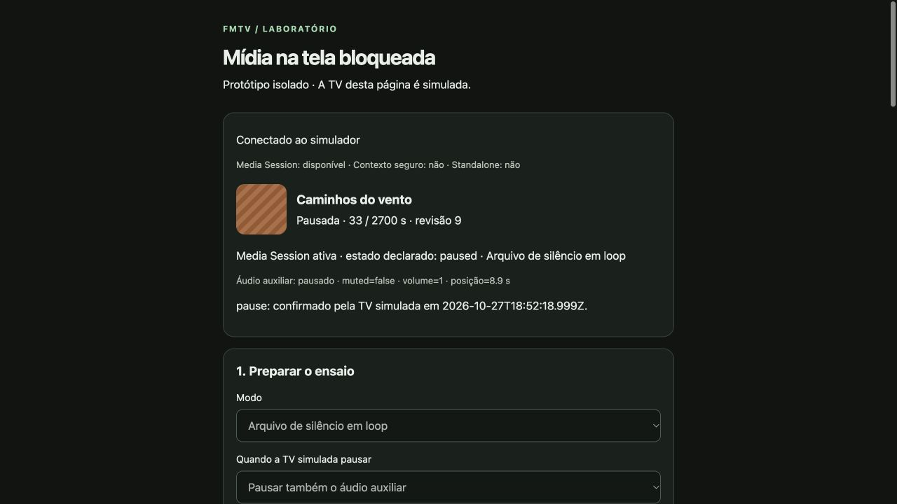

# Validação local do protótipo de Media Session

> **Histórico de experimento descartado.** Recurso revertido em 2026-10-27 a pedido do usuário. Resultados abaixo não descrevem a versão atual.

Data: 2026-10-27. Ticket [01](issues/01-browser-prototype.md).

## Resultado e limite

Ferramenta pronta para o [teste físico 02](issues/02-physical-browser-validation.md). Validada no navegador integrado do Mac, no HTTP de localhost e no endereço HTTP da LAN. **Nenhum teste de tela bloqueada, botão de mídia do sistema, iPhone físico ou ação na TV real foi realizado.** Todas as observações físicas do relatório permaneceram `Não avaliado`.

## Verificado

- `node --check` em `server.mjs` e `app.js`; JSON do manifesto e formatação dos arquivos de texto válidos.
- WAV PCM mono 16 kHz/16 bits de 12 segundos: cabeçalho válido e todas as amostras do arquivo de silêncio iguais a zero.
- Quinze verificações locais HTTP/WebSocket passaram: página inicial, quatro caminhos não permitidos retornando 404, byte-range de áudio 206, range inválido 416, amostras silenciosas, pausa repetida sem alternância, troca de alvo, rejeição de alvo antigo, seek negativo rejeitado, agendamento confirmado, cancelamento efetivo e origem WebSocket externa recusada com 403.
- No navegador do Mac, ativação por toque iniciou o WAV com `muted=false` e volume 1. Handlers de play/pause/seek/próxima/anterior foram aceitos; aceitação do registro não prova existência dos botões no iPhone.
- Em `keep`, pause/play enviados pelos botões da página receberam confirmação no servidor; o áudio auxiliar continuou tocando durante a pausa e o estado declarado acompanhou o simulador.
- Operador em outra aba agendou próximo título após 2 segundos; o cliente recebeu o novo título/capa sem comando enviado pelo próprio cliente.
- Em `follow`, ativar com a TV simulada já pausada, retomar e pausar novamente funcionaram. Foi corrigida uma corrida em que `pause()` era chamado antes de a primeira promessa de `play()` concluir; o cenário foi repetido após a correção.
- No endereço LAN, a página mostrou Media Session disponível e contexto seguro **não**, no navegador do Mac. Esse resultado não mede exposição da API no Safari do iPhone.
- Desativação limpou áudio e Media Session sem enviar pause; exportação gerou resumo e link de JSON com todos os campos físicos não avaliados.

## Executar novamente

Ver [README do protótipo](prototype/README.md). Na sessão desta verificação:

- Telefone: `http://192.168.100.227:8768/`.
- Operador: `http://192.168.100.227:8768/?operator=1`.

O processo precisa continuar ativo e o Mac acordado. IP e disponibilidade são circunstanciais; o comando do README imprime os endereços válidos ao iniciar. Não executar tickets 03–07 com base apenas neste relatório.
