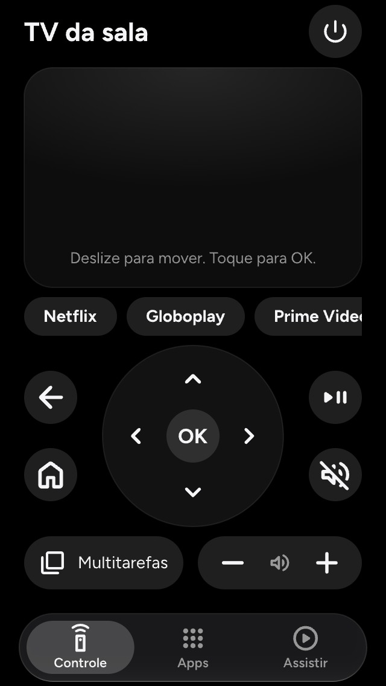

<div align="center">

# FMTV Controller

**The iPhone remote for a TV running [Free My TV](https://github.com/felipevgomes10/free-my-tv): Touchpad and D-pad together, in Safari, from the Home Screen, with no app to install.**


</div>

---

The Remote is always under a cushion. Everyone in the house already has an iPhone on the sofa, but the TV gives them nothing to use it for: Google's own phone remote expects Google's launcher, which Free My TV replaces. **FMTV Controller** puts a Touchpad and a D-pad on the same screen: swipe to move the TV's focus or use the directional buttons, with both always available. It opens from an icon on the iPhone's Home Screen.

It is not an App Store app. It is a page the Free My TV Home serves on the home network, added to the Home Screen from Safari, and paired once with a code the TV shows.

## Design previews

All previews below are exported from the current [`design.pen`](design.pen). The interface is in pt-BR.

<table>
  <tr>
    <td width="33%"><br><sub><b>Controles</b> — Touchpad, D-pad and the Remote's buttons</sub></td>
    <td width="33%"><br><sub><b>Swiping</b> — a light follows the finger</sub></td>
    <td width="33%"><br><sub><b>Adicionar à Tela de Início</b> — the first open, in Safari</sub></td>
  </tr>
  <tr>
    <td width="33%"><br><sub><b>Parear</b> — the code the TV shows and a name for the phone</sub></td>
    <td width="33%"><br><sub><b>Sem conexão</b> — with a button to try turning the TV on</sub></td>
    <td width="33%"><br><sub><b>Revogado</b> — the Owner removed this iPhone on the TV</sub></td>
  </tr>
  <tr>
    <td width="33%"><br><sub><b>Código errado</b> — every refusal says what to do</sub></td>
    <td width="33%"><br><sub><b>A TV não ligou</b> — after Tentar ligar a TV</sub></td>
    <td width="33%"><br><sub><b>Não vinculado</b> — the Owner links it on the TV</sub></td>
  </tr>
</table>

<details>
<summary><b>Compact controls and the other tabs</b></summary>
<br>

The compact layout keeps the Touchpad and D-pad visible together at an available app viewport of 320 × 568. The Shortcut Buttons and the Apps and Assistir tabs arrived in page v0.2.0 with the Home's v0.6.0 ([companion features' spec](.scratch/companion/spec.md), [ADR 0006](docs/adr/0006-companion-features-ask-the-home.md)).

<table>
  <tr>
    <td width="33%"><br><sub><b>Controles compactos</b> — both navigation surfaces stay visible</sub></td>
    <td width="33%"><br><sub><b>Apps</b> — Open Apps, Entradas and every app</sub></td>
    <td width="33%"><br><sub><b>Assistir</b> — Continuar assistindo and Explorar</sub></td>
  </tr>
</table>

</details>

Teclado is excluded after the TV experiments failed to meet the required behavior across apps ([ADR 0007](docs/adr/0007-typing-needs-a-supported-text-field.md)). Its old design frames remain labeled as archived studies.

## What it does

**The controls**

- **Touchpad** — swipe to move the TV's focus, one step every 48 px; tap for OK; touch and hold to hold OK, which opens Edit Mode on the Home. A tap is never mistaken for a short swipe.
- **D-pad** — four directions and OK below the Touchpad, with both visible at the same time. Hold a direction to keep moving; tap OK to select, or hold it for a long press. Repetition stops on release, cancellation, loss of connection, leaving the Controls tab, or putting the page in the background. Native keyboard and assistive clicks also work.
- **Buttons** — Voltar, Home (twice for the App Switcher, held for the Notification Panel, as on the Remote), play/pause, mute, and volume, which keeps changing while held. Power sits apart at the top, away from the thumb.
- **Multitarefas** — beside the horizontal volume capsule, opens the App Switcher over the app visible on the TV. Touchpad or D-pad navigates it; Voltar dismisses it ([ADR 0008](docs/adr/0008-a-dedicated-button-opens-the-app-switcher-over-the-app.md)).
- **Haptics** — Safari uses a native switch label for button taps, and a directly dragged native switch for the Touchpad. The switch's coordinates follow the real finger to produce ticks during navigation; no synthetic click is used. Native tracking has an initial delay, and several steps in one touch event may share a tick. Browsers with the Vibration API use that API instead. The controls work the same without haptics.
- **Shortcut Buttons** — under the Touchpad, a row with the Remote's Netflix, Globoplay, Prime Video, Disney+, YouTube and Input buttons, each named after what the Owner assigned to it and doing what the Remote's button does.

The Touchpad and the existing buttons' haptics are physically checked in the Chrome-installed PWA on the owner's iPhone with iOS 26.6.2. The new D-pad reuses the button behavior; its physical haptics have not yet been checked. Native switch props use boolean `true`: an empty string would be coerced to `false` by WebKit and silently turn these controls back into ordinary checkboxes. The regression tests model this writable, attribute-reflecting DOM property.

**The Apps tab** (page v0.2.0 with the Home's v0.6.0)
- **Abertos** — the Open Apps, most recent first, with their App Banners: a tap switches the TV back to one, its ✕ closes it; an app playing music says *Tocando* and has no ✕.
- **Entradas** — the TV's Inputs by the names the Owner gave them; a tap switches the TV to one.
- **Todos os apps** — every installed app, App Tray first, each opening on the TV with a tap.

**The Assistir tab** (page v0.2.0 with the Home's v0.6.0)
- **Busca** — search movies and series by name, in Portuguese, from TMDB through the TV; results come as you type, with year and kind, and open the Title's screen.
- **Continuar assistindo** — the TV's Up Next Tray: each title's still with its progress, the episode, the app and the time left ("Netflix, faltam 18 min"); a tap resumes it on the TV.
- **Em alta hoje** — Explorar's trending movies and series of the day, with their backdrops from TMDB; a tap opens the Title's screen.
- **A Title's screen** — age rating, kind, year, genre, duration or seasons, rating and synopsis; **Ver trailer na TV** plays the Trailer on the TV, and **Onde assistir** opens the Title in each service's app on the TV, or its Play Store page when the app isn't installed.


**Pairing**
- **Adicionar à Tela de Início first** — opened in a Safari tab, FMTV Controller shows how to add it to the Home Screen, so the pairing lands in the icon you will use. It can still pair right there if you ask.
- **A code from the TV** — type the 4 digits the TV shows on *Configurações → FMTV Controller → Parear aparelho* and give the iPhone a name ("iPhone da Ana"); from then on it opens straight to the controls.
- **Clear refusals** — a wrong code, the TV's pairing screen being closed, too many tries, or a TV out of reach each say what to do.

**When the TV is out of reach**
- **Sem conexão** — the controls dim and the Touchpad says why; FMTV Controller tries again by itself, at once when you come back to it, and returns to the controls without a reload.
- **Tentar ligar a TV** — a best-effort wake: if the Home answers within 5 seconds it sends `wake`, which can turn a TV on but never off; otherwise it says to use the Remote.
- **Never late keys** — a key pressed while out of reach is dropped, never sent when the TV comes back.
- **Not linked, revoked** — a Home not yet linked to the TV, or an iPhone the Owner removed, each get a screen saying who fixes it; a revoked iPhone can pair again.

**A Home Screen app**
- **FMTV Controller** on the Home Screen, with its icon, opening standalone in portrait under a translucent status bar.
- **Opens with the TV off** — a network-first service worker ([ADR 0004](docs/adr/0004-a-network-first-service-worker.md)) keeps a copy of the page: when the Home answers, every open gets the page it serves now; when it doesn't within 3 seconds, the copy opens on Sem conexão instead of Safari's error page.

**On the TV** (in [free-my-tv](https://github.com/felipevgomes10/free-my-tv))
- **Linking** — *Configurações → FMTV Controller → Vincular* asks Android's "Allow debugging?" once; accepted with "always allow", the Home can send real keys to every app.
- **Parear aparelho** — the TV's address as a QR code and a 4-digit code that exists only while the screen is open and changes after each phone, or after 3 wrong tries.
- **Aparelhos pareados** — every Paired Phone by its name, each revocable; a revoked iPhone is closed at once.

**Status:** working on the owner's TCL with an iPhone 17 Pro, since page v0.1.0 and the Home's v0.5.0: in the Home, YouTube and Netflix, a key takes about as long as the Remote's, pairing and revoking work, and Linking survives a reboot of the TV. The original script-triggered haptic gave no tick on that iPhone, consistent with [WebKit's trusted-event requirement](https://github.com/WebKit/WebKit/commit/fc1ef83). On iOS 26.6.2 the owner confirmed haptics during real native dragging in the standalone prototype, including immediate, reverse and fast swipes. Its report records 54 navigation steps and 41 candidate requests (13 early steps); exact physical pulse counts are not measured. The owner then checked the integrated production pad locally and confirmed swipe haptics, a single OK on tap, and hold-start/hold-end on holding and releasing. The Shortcut Buttons and the Apps and Assistir tabs of v0.2.0 are checked on the Android TV emulator with the real Home and TMDB; their walk on the TV is still to come.

The D-pad is implemented in the current source and checked against the fake bridge and in the browser, including simultaneous Touchpad use and layouts from 320 × 568 to 430 × 932. It has not yet been installed and checked on the TV.

## How it works

```
             the iPhone                                     the TV
┌──────────────────────────────────┐       ┌──────────────────────────────────────────┐
│ FMTV Controller (Home Screen)    │       │ Free My TV Home                          │
│   Touchpad + D-pad ── keys ──────┼──WS──►│   bridge ── keys ──► the TV's own ADB    │
│                      ◄── state ──┼───────┤     │      (127.0.0.1:5555, cmd input)   │
│   served by the Home over HTTP   │◄──────┤   serves this page at the version it     │
└──────────────────────────────────┘       │   pins from this repository's releases   │
                                           └──────────────────────────────────────────┘
```

- **Keys go through the TV's own ADB** ([ADR 0005](docs/adr/0005-keys-through-the-tvs-own-adb.md)). A browser can't make another app receive a key, and neither can an ordinary app, so a bridge inside the Home passes each key to the TV's own debugging bridge, which Setup already keeps on, as a real key event. The TV Remote Service that Google's phone remote uses was the first plan ([ADR 0001](docs/adr/0001-keys-through-android-tv-remote-protocol-bridged-by-the-home.md)), until it turned out to refuse keys from the TV itself.
- **The page ships inside the Home** ([ADR 0002](docs/adr/0002-the-page-ships-inside-the-home.md)). Each release here is a versioned zip; the Home pins one and serves it next to its bridge, so page and bridge always speak the same version.
- **Plain HTTP on the home network** ([ADR 0003](docs/adr/0003-plain-http-on-the-home-network.md)), as APK Drop does.
- **A network-first service worker** ([ADR 0004](docs/adr/0004-a-network-first-service-worker.md)) keeps the page openable when the TV isn't, without ever hiding a Home update.
- **Keys are intentions, not key codes** — `right`, `ok`, `home`, each pressed, held or released. The messages and their JSON examples are in [`protocol/`](protocol); both projects' tests read the same examples.

The language of the project — *Web Remote*, *Pairing*, *Paired Phone*, *Linking*, *Touchpad*… — is defined in [`CONTEXT.md`](CONTEXT.md); every decision with a trade-off is an [ADR](docs/adr).

## Getting started

You need **Node 24** and npm.

```bash
npm install
npm run dev
```

Open the address Vite prints, on the computer or on an iPhone on the same Wi-Fi. A fake bridge runs inside the dev server: it answers like the Home, pairs with the code **4827**, calls the TV "TV de teste", and prints every pairing and key it receives:

```
[ponte de teste] pareamento de "iPhone da Ana" com 4827: aceito
[ponte de teste] right press
[ponte de teste] ok hold-start
```

### With the Home

To try the page against the real bridge, build the Home with a local zip instead of a pinned release, and install it on an Android TV emulator:

```bash
scripts/release.sh 0.1.0 --dry-run
```

```bash
cd ../free-my-tv && ./gradlew :app:assembleDebug -PwebRemoteZip=../free-my-tv-remote-controller/release/web-remote-0.1.0.zip
```

Then link the Home in *Configurações → FMTV Controller*, open *Parear aparelho*, forward the bridge's port to your computer and open it in a browser:

```bash
adb -s emulator-5554 forward tcp:8766 tcp:8766
```

## Scripts

| Script | What it's for |
| --- | --- |
| `npm run dev` | The page with the fake bridge, on the network, with live reload. |
| `npm test` | The page's tests: the real page, driven through its controls, against a fake bridge speaking the protocol's examples. |
| `npm run build` | Type-checks and builds the page into `dist/`. |
| `npm run preview` | Serves the built page, with the fake bridge and the service worker. |
| [`scripts/release.sh`](scripts/release.sh) | Builds, tests and publishes a versioned zip on GitHub, for the Home to pin. |

### `release.sh` — ship the page to the Home

```bash
scripts/release.sh 0.2.0 --dry-run   # build the zip only
scripts/release.sh 0.2.0             # build, then type "sim" to publish
```

From a clean `main`, it bumps the version in `package.json`, runs the tests, builds the page and zips it as `release/web-remote-<version>.zip`, printing its SHA-256 next to it. The zip holds two folders: `page/`, which the Home serves, and `protocol/`, whose examples the Home's tests read. After you type `sim`, it commits, tags `v<version>`, pushes `main` and the tag, and creates the GitHub release with the zip and its `.sha256`.

To ship a release in the Home, set both lines it prints in free-my-tv's `gradle.properties` and release the Home:

```properties
webRemoteVersion=0.2.0
webRemoteSha256=<the SHA-256 printed>
```

The Home's build downloads that zip, refuses it if the checksum differs, and puts the page in the APK. A new page reaches the TV only with a new Home.

## Development

```
src/
├── app.tsx          the page: Adicionar à Tela de Início, Pairing, then the tabs
├── bridge.ts        the page's side of the protocol: keys, and requests answered by id
├── pictures.tsx     the Home's pictures, fetched once with the credential in a header
├── connection.ts    one connection kept alive: retries, Tentar ligar, reload once
├── gestures.ts      the Touchpad's taps, holds and swipes, turned into keys
├── haptics.ts       the optional Vibration API tick (Safari uses components/HapticFeedback.tsx)
├── pairing.ts       Pairing's request, and telling a Safari tab from the Home Screen app
├── protocol.ts      the protocol's messages and version
├── service-worker.js  the network-first copy of the page (ADR 0004)
├── storage.ts       the Paired Phone's credential and the last TV's name
└── components/      TabBar, TabPage, Controls, Touchpad, Dpad, RemoteButton, MultitaskingButton, PairingScreen, AddToHomeScreen, MessageScreen, Icon
protocol/            the protocol's contract and its JSON examples
tests/               tests against a fake bridge (mock-socket)
dev/                 the fake bridge for `npm run dev`
plugins/             the build's service worker, with every file to keep
public/              the web app manifest and the app icons
docs/adr/            decisions and their trade-offs
docs/design/         design exports of design.pen
```

The tests render the real page in jsdom and touch it like a finger would: pointer events on the Touchpad and the buttons, with fake timers for holds, repeats and retries, and typing into the Pairing form. The fake bridge can go down and come back, refuse a credential or ask for a newer page. What they check is only what crosses to the bridge — the WebSocket and the `/pair` request — and what the page shows.

## Credits

Icons are [Material Symbols](https://fonts.google.com/icons) (Apache 2.0); the typeface is [Figtree](https://fonts.google.com/specimen/Figtree) (OFL), as in the Home. FMTV Controller is a personal project, not affiliated with TCL, Google or Apple.
