<div align="center">

# FMTV Controller

**The iPhone remote for a TV running [Free My TV](https://github.com/felipevgomes10/free-my-tv): swipe, tap, done — in Safari, from the Home Screen, with no app to install.**


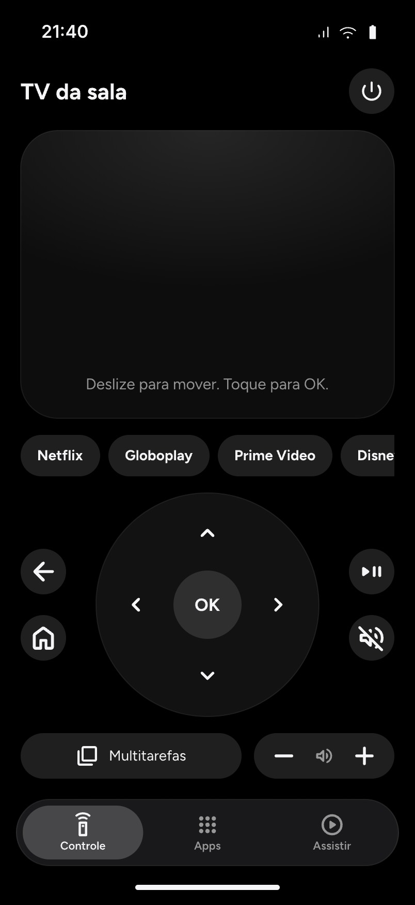

</div>

---

The Remote is always under a cushion. Everyone in the house already has an iPhone on the sofa, but the TV gives them nothing to use it for: Google's own phone remote expects Google's launcher, which Free My TV replaces. **FMTV Controller** is a remote control in the spirit of the Apple TV Remote: a Touchpad that moves the TV's focus as you swipe, and the buttons you reach for most, opened from an icon on the iPhone's Home Screen.

It is not an App Store app. It is a page the Free My TV Home serves on the home network, added to the Home Screen from Safari, and paired once with a code the TV shows.

## Design previews

All previews below are exported from the current [`design.pen`](design.pen). The interface is in pt-BR.

<table>
  <tr>
    <td width="33%"><br><sub><b>Controles</b> — the Touchpad and the Remote's buttons</sub></td>
    <td width="33%">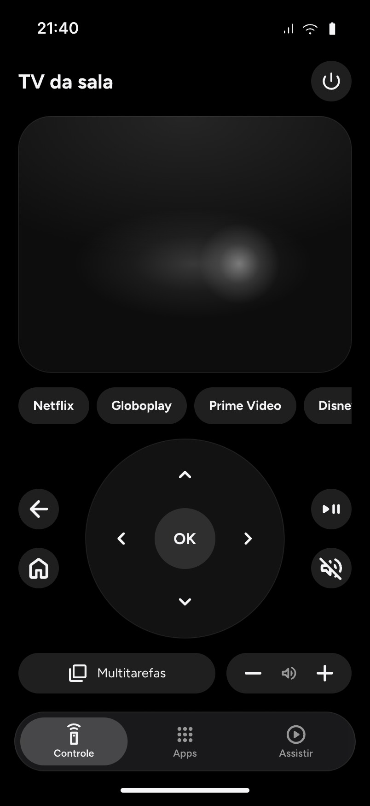<br><sub><b>Swiping</b> — a light follows the finger and trails behind it</sub></td>
    <td width="33%">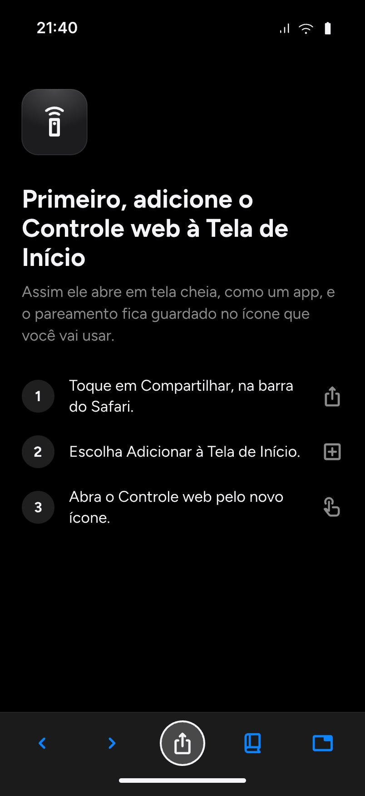<br><sub><b>Adicionar à Tela de Início</b> — the first open, in Safari</sub></td>
  </tr>
  <tr>
    <td width="33%">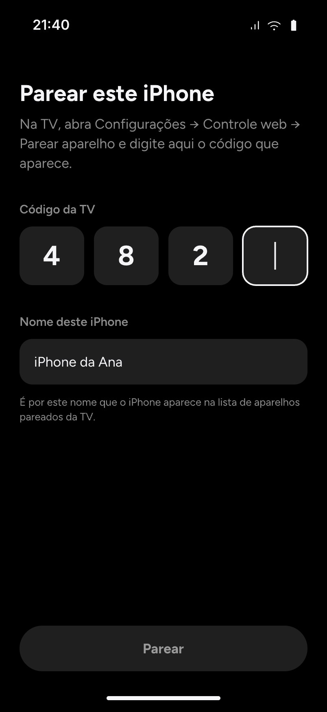<br><sub><b>Parear</b> — the code the TV shows and a name for the phone</sub></td>
    <td width="33%">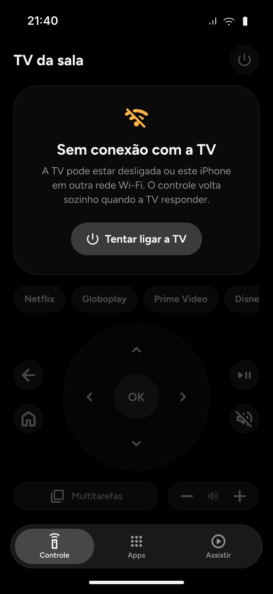<br><sub><b>Sem conexão</b> — with a button to try turning the TV on</sub></td>
    <td width="33%">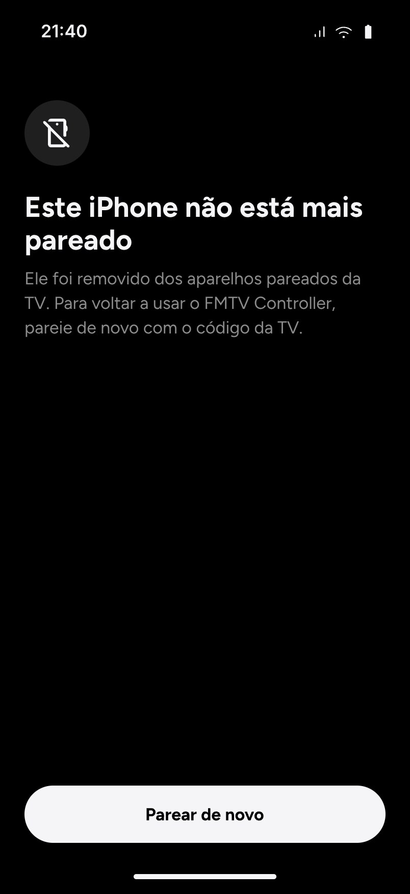<br><sub><b>Revogado</b> — the Owner removed this iPhone on the TV</sub></td>
  </tr>
  <tr>
    <td width="33%">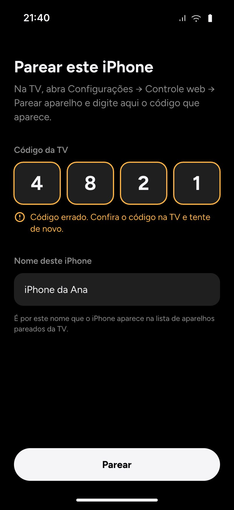<br><sub><b>Código errado</b> — every refusal says what to do</sub></td>
    <td width="33%">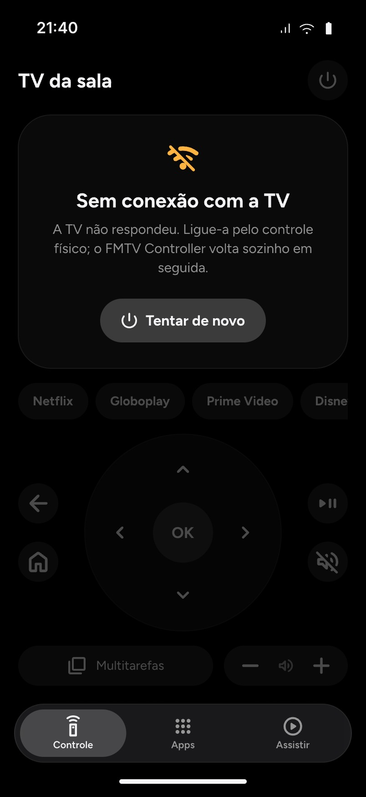<br><sub><b>A TV não ligou</b> — after Tentar ligar a TV</sub></td>
    <td width="33%">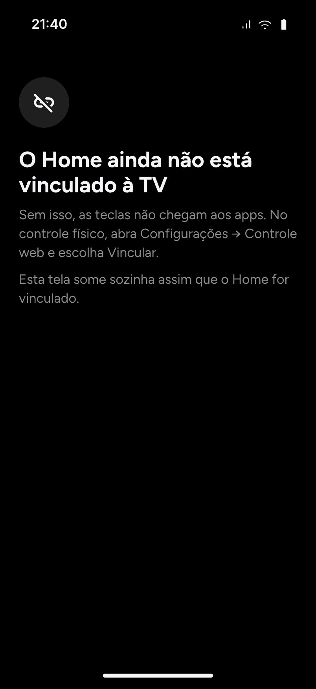<br><sub><b>Não vinculado</b> — the Owner links it on the TV</sub></td>
  </tr>
</table>

<details>
<summary><b>Coming after the first release</b></summary>
<br>

<table>
  <tr>
    <td width="33%">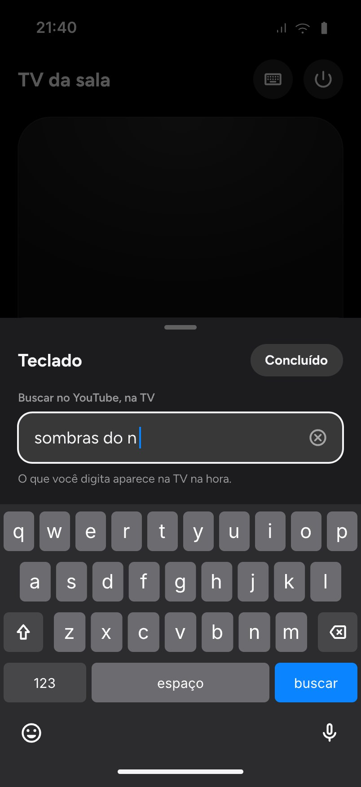<br><sub><b>Teclado</b> — type into the field open on the TV</sub></td>
    <td width="33%">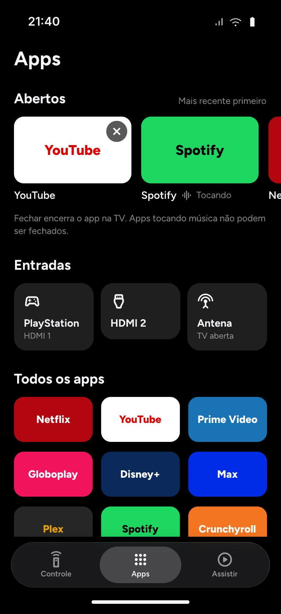<br><sub><b>Apps</b> — Open Apps, Entradas and every app</sub></td>
    <td width="33%">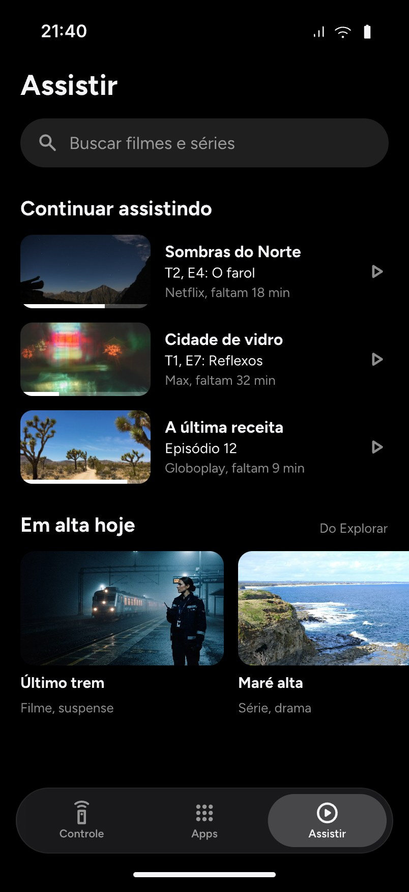<br><sub><b>Assistir</b> — Continuar assistindo and Explorar</sub></td>
  </tr>
</table>

</details>

## What it does

**The controls**
- **Touchpad** — swipe to move the TV's focus, one step every 48 px; tap for OK; touch and hold to hold OK, which opens Edit Mode on the Home. A tap is never mistaken for a short swipe.
- **Buttons** — Voltar, Home (twice for the App Switcher, held for the Notification Panel, as on the Remote), play/pause, mute, and volume, which keeps changing while held. Power sits apart at the top, away from the thumb.
- **Haptics** — a tick for every step and press where iOS allows it; the controls work the same without one.

**Pairing**
- **Adicionar à Tela de Início first** — opened in a Safari tab, FMTV Controller shows how to add it to the Home Screen, so the pairing lands in the icon you will use. It can still pair right there if you ask.
- **A code from the TV** — type the 4 digits the TV shows on *Configurações → FMTV Controller → Parear aparelho* and give the iPhone a name ("iPhone da Ana"); from then on it opens straight to the controls.
- **Clear refusals** — a wrong code, the TV's pairing screen being closed, too many tries, or a TV out of reach each say what to do.

**When the TV is out of reach**
- **Sem conexão** — the controls dim and the Touchpad says why; FMTV Controller tries again by itself, at once when you come back to it, and returns to the controls without a reload.
- **Tentar ligar a TV** — a best-effort wake: if the Home answers within 5 seconds it sends `wake`, which can turn a TV on but never off; otherwise it says to use the Remote.
- **Never late keys** — a key pressed while out of reach is dropped, never sent when the TV comes back.
- **Not linked, revoked** — a Home not yet linked to the TV, or an iPhone the Owner removed, each get a screen saying who fixes it; a revoked iPhone can pair again.

**A Home Screen app**
- **FMTV Controller** on the Home Screen, with its icon, opening standalone in portrait under a translucent status bar.
- **Opens with the TV off** — a network-first service worker ([ADR 0004](docs/adr/0004-a-network-first-service-worker.md)) keeps a copy of the page: when the Home answers, every open gets the page it serves now; when it doesn't within 3 seconds, the copy opens on Sem conexão instead of Safari's error page.

**Status:** the whole page is built and tested against a fake bridge. The Home's side — Linking, Pairing on the TV and the bridge — is in progress in [free-my-tv](https://github.com/felipevgomes10/free-my-tv/tree/main/.scratch/web-remote/issues). Pairing, the Home's bridge and the rest of the first release are in progress — see [the tickets](.scratch/web-remote/issues) and the Home's side in [free-my-tv](https://github.com/felipevgomes10/free-my-tv/tree/main/.scratch/web-remote/issues).

## How it works

```
             the iPhone                                     the TV
┌──────────────────────────────────┐       ┌──────────────────────────────────────────┐
│ FMTV Controller (Home Screen)    │       │ Free My TV Home                          │
│   Touchpad, buttons ── keys ─────┼──WS──►│   bridge ── keys ──► TV Remote Service   │
│                      ◄── state ──┼───────┤     │                  (127.0.0.1)       │
│   served by the Home over HTTP   │◄──────┤   serves this page at the version it     │
└──────────────────────────────────┘       │   pins from this repository's releases   │
                                           └──────────────────────────────────────────┘
```

- **Keys go through the TV's own remote service** ([ADR 0001](docs/adr/0001-keys-through-android-tv-remote-protocol-bridged-by-the-home.md)). A browser can't make another app receive a key, so a bridge inside the Home passes each key to the TV Remote Service, the one Google's phone remote uses.
- **The page ships inside the Home** ([ADR 0002](docs/adr/0002-the-page-ships-inside-the-home.md)). Each release here is a versioned zip; the Home pins one and serves it next to its bridge, so page and bridge always speak the same version.
- **Plain HTTP on the home network** ([ADR 0003](docs/adr/0003-plain-http-on-the-home-network.md)), as APK Drop does.
- **A network-first service worker** ([ADR 0004](docs/adr/0004-a-network-first-service-worker.md)) keeps the page openable when the TV isn't, without ever hiding a Home update.
- **Keys are intentions, not key codes** — `right`, `ok`, `home`, each pressed, held or released. The messages and their JSON examples are in [`protocol/`](protocol); both projects' tests read the same examples.

The language of the project — *Web Remote*, *Pairing*, *Paired Phone*, *Linking*, *Touchpad*… — is defined in [`CONTEXT.md`](CONTEXT.md); every decision with a trade-off is an [ADR](docs/adr).

## Getting started

You need **Node 24** and npm.

```bash
npm install
npm run dev
```

Open the address Vite prints, on the computer or on an iPhone on the same Wi-Fi. A fake bridge runs inside the dev server: it answers like the Home, pairs with the code **4827**, calls the TV "TV de teste", and prints every pairing and key it receives:

```
[ponte de teste] pareamento de "iPhone da Ana" com 4827: aceito
[ponte de teste] right press
[ponte de teste] ok hold-start
```

## Scripts

| Script | What it's for |
| --- | --- |
| `npm run dev` | The page with the fake bridge, on the network, with live reload. |
| `npm test` | The page's tests: the real page, driven through its controls, against a fake bridge speaking the protocol's examples. |
| `npm run build` | Type-checks and builds the page into `dist/`. |
| `npm run preview` | Serves the built page, with the fake bridge and the service worker. |
| [`scripts/release.sh`](scripts/release.sh) | Builds, tests and publishes a versioned zip on GitHub, for the Home to pin. |

### `release.sh` — ship the page to the Home

```bash
scripts/release.sh 0.2.0 --dry-run   # build the zip only
scripts/release.sh 0.2.0             # build, then type "sim" to publish
```

From a clean `main`, it bumps the version in `package.json`, runs the tests, builds the page and zips it as `release/web-remote-<version>.zip`, printing its SHA-256 next to it. The zip holds two folders: `page/`, which the Home serves, and `protocol/`, whose examples the Home's tests read. After you type `sim`, it commits, tags `v<version>`, pushes `main` and the tag, and creates the GitHub release with the zip and its `.sha256`.

To ship a release in the Home, set both lines it prints in free-my-tv's `gradle.properties` and release the Home:

```properties
webRemoteVersion=0.2.0
webRemoteSha256=<the SHA-256 printed>
```

The Home's build downloads that zip, refuses it if the checksum differs, and puts the page in the APK. A new page reaches the TV only with a new Home.

## Development

```
src/
├── app.tsx          the page: Adicionar à Tela de Início, Pairing, then the controls
├── bridge.ts        the page's side of the protocol over WebSocket
├── connection.ts    one connection kept alive: retries, Tentar ligar, reload once
├── gestures.ts      the Touchpad's taps, holds and swipes, turned into keys
├── haptics.ts       the haptic tick, through Safari's switch control
├── pairing.ts       Pairing's request, and telling a Safari tab from the Home Screen app
├── protocol.ts      the protocol's messages and version
├── service-worker.js  the network-first copy of the page (ADR 0004)
├── storage.ts       the Paired Phone's credential and the last TV's name
└── components/      Controls, Touchpad, RemoteButton, PairingScreen, AddToHomeScreen, MessageScreen, Icon
protocol/            the protocol's contract and its JSON examples
tests/               tests against a fake bridge (mock-socket)
dev/                 the fake bridge for `npm run dev`
plugins/             the build's service worker, with every file to keep
public/              the web app manifest and the app icons
docs/adr/            decisions and their trade-offs
docs/design/         design exports of design.pen
```

The tests render the real page in jsdom and touch it like a finger would: pointer events on the Touchpad and the buttons, with fake timers for holds, repeats and retries, and typing into the Pairing form. The fake bridge can go down and come back, refuse a credential or ask for a newer page. What they check is only what crosses to the bridge — the WebSocket and the `/pair` request — and what the page shows.

## Credits

Icons are [Material Symbols](https://fonts.google.com/icons) (Apache 2.0); the typeface is [Figtree](https://fonts.google.com/specimen/Figtree) (OFL), as in the Home. FMTV Controller is a personal project, not affiliated with TCL, Google or Apple.
